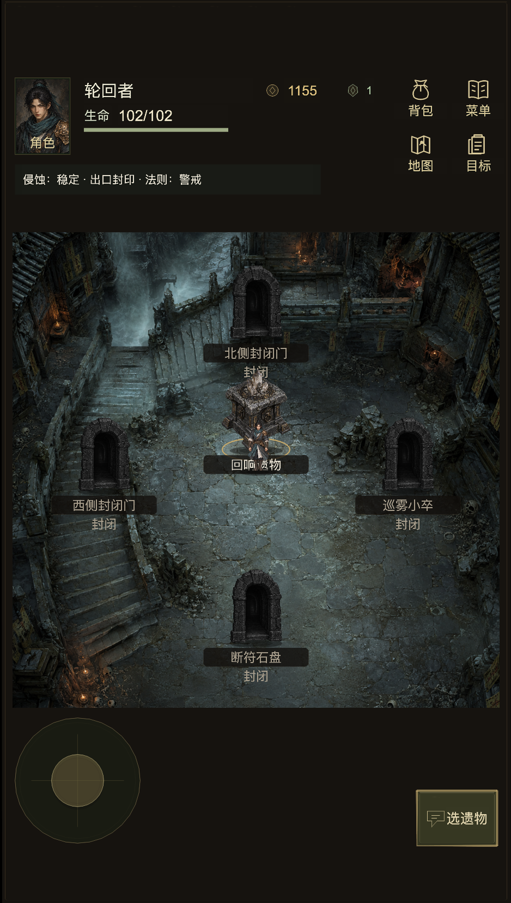
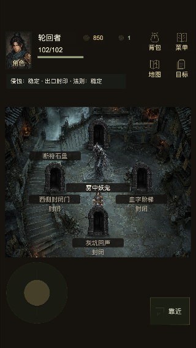
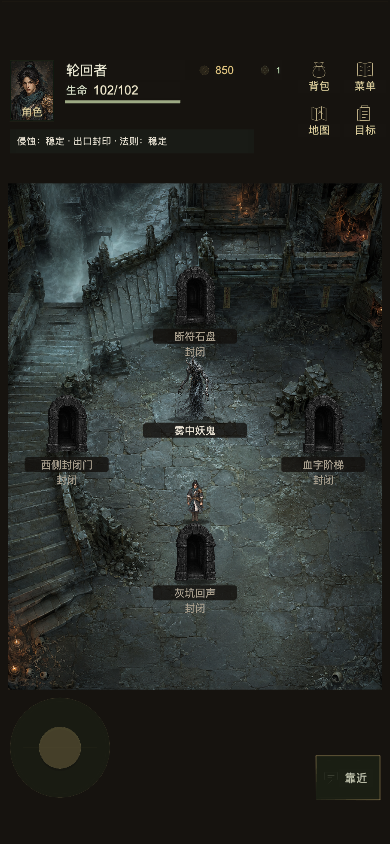
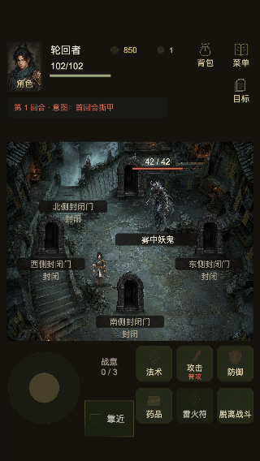
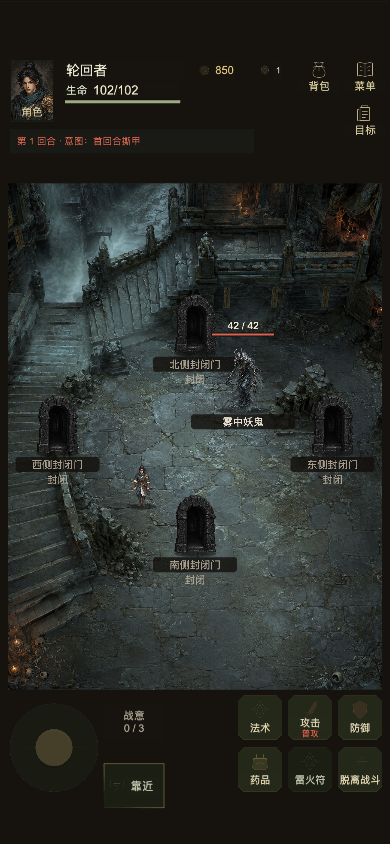

# 副本单屏房间验收

已将 `prototype/dungeon-room-fit-v1` 应用到 Cocos 探索与战斗。房间采用固定等比投影，
四向门完整入屏，HUD 和底部操作区独立保留。中央物体仍按实际节点显示怪物、奖励、
事件或遗物；缺少相邻节点的方向显示封闭门，战斗期间四门封闭。

## 实现与边界

- 保留世界尺寸、key、出生点、当前坐标、互动范围、原有命令和存档格式。
- 删除六块内部碎石，保留世界 perimeter；同方向多个真实邻居继续保留。
- 房门、怪物与角色保持素材比例，文字按屏幕尺寸显示。短房间北门字牌放在门旁。
- 六个战斗入口保留为两排 44px 点击区；特效遮罩和锚点使用同一固定投影。
- 固定偏移对应的背景覆盖范围已补齐，房间顶部没有额外空带。

本次交付是本地 Creator Web Mobile 构建，未上传微信体验版或发布。

## 验证

| 验证 | 结果 |
| --- | --- |
| walk-world | 45 checks；19 章、570 节点、1862 条真实邻居绑定、59 怪物身份通过 |
| bootstrap-race | 153 scenarios；8 个房间/安全区组合、4 个特效锚点检查通过 |
| Cocos / Creator typecheck | 两项通过 |
| source / scene 验证 | 两项通过 |
| Creator 3.8.8 | `web-mobile-room-fit-20261013` 构建完成，HTTP 200，实际场景 ready |
| 实际 Cocos 画面 | 探索/战斗 × 320×568/390×844，共 4 组、20 个门/怪物图像完整入屏 |
| 实际输入 | 摇杆移动时相机固定、领域状态和 revision 不变；真实点击攻击完成回合 |
| 浏览器控制台 | 实际验证中 error 0 |

实际攻击使用独立默认角色样本，无属性增强：敌人 HP 42→24，回合 1→2，revision 2→3。
用户当前进度没有用于该攻击测试。

证据：[布局](engine-layout-validation.json)、[实际输入](engine-interaction-validation.json)、
[回归日志](race-final.log)、[类型检查](typecheck-final.log)、[世界投影日志](walk-final.log)。

## 当前进度

通过正式 client/codec 恢复当前游戏，并对领域状态、volatile/durable storage、durability、
revision、剩余随机种子、local UI、View UI、弹框和人物位置等十项回读，全部一致。
HP 102、轮回点 1155、revision 9；仍在巡哨布袋节点，雾锋已选中但尚未确认，
原本关闭的弹框保持关闭。迁移没有消费随机种子。

[十项回读](live-preservation-validation.json)。完整存档备份保留在本机临时目录，
没有放入此验收目录。

## 小屏实际截图

| 探索 320×568 | 探索 390×844 |
| --- | --- |
|  |  |

| 战斗 320×568 | 战斗 390×844 |
| --- | --- |
|  |  |

[实际攻击画面](natural-combat-action-390.png)。
