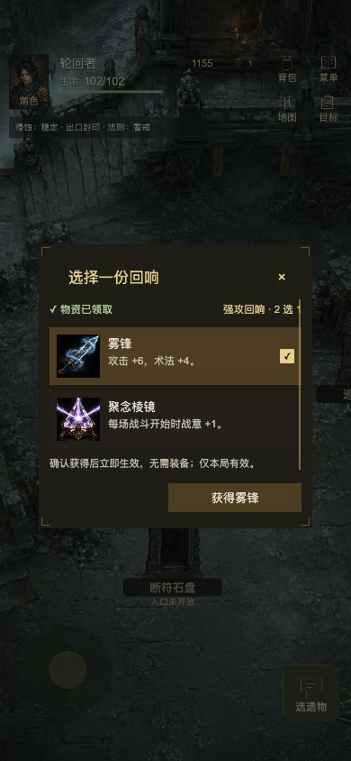

# 全弹框整合验收 · 2026-10-13

已将 `prototype/modal-system-v1` 的紧凑样式整合到真实 Cocos Creator 3.8.8 Web Mobile 构建。覆盖角色、行囊、地图、任务、记录、菜单、现场选择、入场、NPC、帮助目录与结算这 11 类 sheet，以及机制帮助、加载/失败、运行阻断、HUD 和物品提示浮层。

窗口宽度上限 304px、高度上限 464px，正文滚动区上限 300px；按钮视觉高度 32px、触控高度至少 44px、最大宽度 148px。图片等比显示，长文、锁定原因、全部选项和原有确认条件保留。

## 实际引擎验证

- [布局数据](engine-layout-validation.json)：320×568、390×844 各 27 个真实 ViewModel 场景，共 54 个；包含所有 sheet 类别、7 类 NPC 目录、6 类 pending、两种奖励和待归档结算。窗口边界、滚动区和按钮检查均通过。
- [遮罩数据](engine-overlay-validation.json)：两种尺寸下的加载、失败、长诊断阻断，共 6 个实际引擎渲染场景。阻断使用明确的诊断测试文本，原始文本完整保留。
- [实点流程](engine-interaction-validation.json)：在独立测试存档中通过实际指针/拖动事件验证奖励领取、回响禁用与选择、关闭重开、帮助滚动与主题切换、装备提示、HUD 浮层、场景重试和自然撤退结算。

巡哨布袋自然路线测试实际获得奖励点 70、药炉灰 1；未选择时确认无效，选择仅更新界面，确认后雾锋攻击 +6、术法 +4。普通补给龛实际获得奖励点 80、破禁符 1，未产生回响选择。自然撤退后结算背景正常进入 ready。

## 当前进度保留

[完整比对结果](live-preservation-validation.json) 的 10 项检查全部一致：存档原文、耐久镜像、存储方式、领域状态、修订号、剩余随机种子、本地界面状态、页面字段、弹框状态和角色位置。通过正式 `createInfiniteFlowClient` 恢复接口载入，恢复没有派发玩法命令或消费随机种子。

当前仍在巡哨布袋，HP 102、奖励点 1155，revision 9；雾锋保持选中但未确认。截图只临时打开该弹框，完成后恢复原先关闭状态和正常视口。原始完整备份保存在本机临时验收目录，不加入本仓库。

## 代表截图

| 内容 | 截图 |
| --- | --- |
| 角色六属性与七槽 | [390](character-390.png) / [320](family-character-320.png) |
| 行囊 | [320](family-inventory-320.png) |
| 地图 | [390](family-map-390.png) |
| 入场与锁定条件 | [390](family-entry-390.png) |
| NPC 装备目录 | [390](family-npc-390.png) |
| 装备三选一 | [320](pending-equipment-offer-320.png) |
| 装备提示 | [320](actual-equipment-tip-320.png) |
| 完整帮助 | [320](actual-help-320.png) / [390](actual-help-390.png) |
| HUD 遗物浮层 | [320](actual-hud-relic-popover-320.png) |
| 自然撤退结算 | [320](actual-natural-result-320.png) |
| 场景失败 / 长诊断 | [失败 320](actual-overlay-error-320.png) / [阻断 390](actual-overlay-blocked-390.png) |

除当前进度截图外，其余截图使用独立测试存档或真实 ViewModel fixture；不把示例余额、解锁状态或测试选择写入用户存档。

## 源码检查

已通过包构建、Cocos/Creator 类型检查、presentation 测试、source/scene 验证、sheet 检查（2028 个真实 ViewModel）、race 检查（145 个场景）、主题检查（33 组）、布局检查（60 组）与平台检查（128 条断言）。本次还修复了原有的结算资源衔接问题：同一已缓存封面从主图转为结算背景时补挂场景，避免一直显示加载遮罩；回归用例在旧条件下准确失败。

缓存图片的 direct/group 租约在等待加载前预占引用，失败时归还，避免交接瞬间释放仍要显示的小图。平台回归覆盖三种缓存交接与失败重试，旧顺序能准确复现已销毁的图片。最新版实际引擎中再次实点「重试场景」后，世界进入 ready，雾锋与聚念棱镜的原生图片及弹框注册均有效，存档 revision 仍为 9；最终 10 项完整进度比对仍全部一致。

本记录为实际 Cocos Web Mobile 引擎验证，不作为微信真机或发布验收。全部修改保留在本地工作区，未发布。
