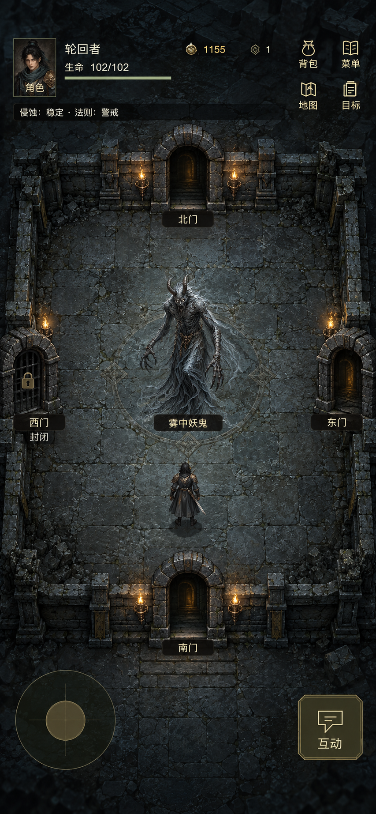

# 副本单屏房间原型 v1

本轮先出图片原型，未接入正式游戏。原型采用现有妖塔石地、雾中妖鬼和石门作为风格参考；不覆盖既有素材或改变当前进度。

## 布局

整间房完整入屏，固定镜头。怪物位于中心，上、下、左、右四扇门分别位于房间边缘中点；角色位于中下部。压缩空地、去掉示例房间的四角碎石，HUD 与底部摇杆、互动按钮各自留出区域。门和怪物的操作热区至少 44px。

| 视口 | HUD | 房间区域 | 底部操作区 |
| --- | --- | --- | --- |
| 390×844 | 0–136 | x12、y142、366×558 | 724–844 |
| 320×568 | 0–136 | x10、y142、300×300 | 448–568 |

这些尺寸是设计目标，图片不是引擎测量结果。[布局数据](layout.json) 保存尺寸和素材参考。

## 玩法边界

图片演示怪物房间，不代表当前巡哨布袋节点。四个方向始终看得见，能否通过仍由真实节点和原有命令决定；封闭方向不会为了展示四门而新增路线。正式整合时中央物体按当前节点类型展示怪物、奖励或事件，保留现有战斗、奖励和分支确认。

当前问题的源码原因是探索房间固定 1000×1000、缩放 1.1，横向可视约 682 world units，镜头还随人物移动。后续整合只调整房间投影、可视尺寸和镜头布局，领域节点图与当前存档不变。
