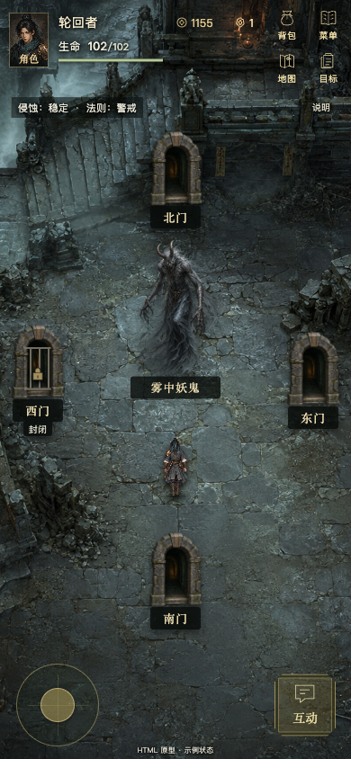
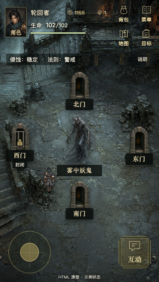

# 副本全屏背景 HTML 原型 v2

保留游戏现有妖塔背景原图，等比铺满整个游戏画面。四向门、中央怪物、角色、HUD
和底部操作分别浮在背景上；房间布局区域本身没有底色、边框或背景裁剪。

本版只新增 HTML 原型，未修改正式 Cocos 游戏或访问真实进度。示例固定为生命
102/102、轮回点 1155、灵蕴 1。门的开放状态只用于此页演示。

[打开本地预览](http://127.0.0.1:8125/prototype/dungeon-room-fullscreen-v2/index.html)
· [HTML 文件](index.html)

## 构图与操作

沿用[图片原型](../dungeon-room-fit-v1/single-screen-room-v1.png)的四向构图：北门在
上方、南门在下方，东西门在两侧，中央为雾中妖鬼，角色位于其下方。采用真实游戏
素材展示，避免把图像合成的墙体或火把替换进原背景。

| 视口 | 门图高度 | 怪物图高度 | 角色高度 |
| --- | --- | --- | --- |
| 390×844 | 90px | 158px | 65px |
| 320×568 | 60px | 108px | 50px |

320 小屏将角色初始位置放在怪物左下方，避免遮挡名称和南门。四门和标签完整入屏，
门点击区至少 44px；图片保持原始比例。背景贯穿 HUD 和透明底部操作区，人物移动
时背景和四向门保持固定。桌面按可用高度缩放完整画板，右侧可切换两种尺寸、查看
上一版构图或重置角色。

可拖动摇杆，或按住 WASD / 方向键移动；靠近目标后点“互动”或按 E。点击门可查看
本地提示，西门保持封闭。手机上的“说明”打开独立说明面板。

## 素材

- 背景：`../../cocos/assets/resources/dungeon-world/demon_tower_1-v1.png`，原文件不变，`object-fit: cover`。
- 门：`../../cocos/assets/resources/dungeon-world/ruined-stone-gate-v1.png`。
- 怪物：`../../cocos/assets/resources/monster-world/fog-lesser-demon-world-v1.png`。
- 头像：`../../cocos/assets/resources/character/reincarnator-v2.png`。
- 角色：`../../cocos/assets/resources/character/reincarnator-walk-v2.png`；CSS 使用现有16帧实测 atlas rect，不修改图片。

## 实际浏览器验收

390×844 和 320×568 两种尺寸验证通过：背景边界等于完整画面，没有滤镜或裁剪框；
页面不溢出，四门及角色完整可见，北门不遮挡中央怪物，角色不遮挡怪物名称或南门。
实际按住摇杆可移动角色，背景和门的 DOM 边界不变；封闭门、靠近互动、说明面板
打开/关闭及重置均通过。浏览器控制台 error 0，脚本语法检查通过。

[浏览器布局与交互记录](validation/browser-validation.json)
· [正式源码、背景及原型原图的哈希未变](validation/unchanged-source-validation.json)

| 390×844 | 320×568 |
| --- | --- |
|  |  |
